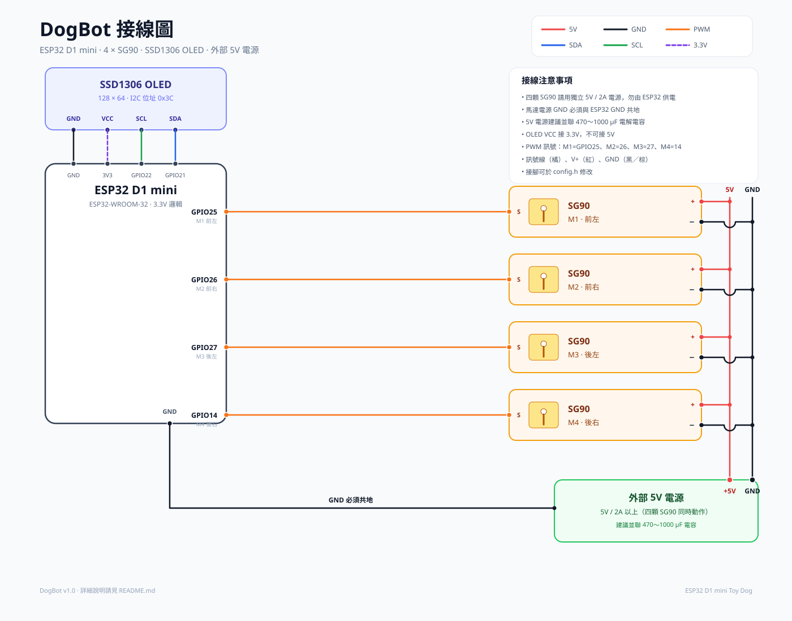

# DogBot — ESP32 D1 mini 玩具狗

以 **ESP32 D1 mini** 製作的四足玩具狗，使用 4 顆 **SG90** 伺服馬達驅動四條腿，
搭配 **SSD1306 OLED** 顯示隨機表情，並以 **SPIFFS + Web Server** 提供完整的中文控制台。

- 開發環境：**Arduino IDE 1.8.19** + ESP32 core 2.x
- 前端：純 HTML / CSS / JavaScript（無外部 CDN，離線可用）
- 後端：ESP32 WebServer + SPIFFS + OTA

---

## 功能

### 前端控制台（Sidebar 五大區塊）

| 區塊 | 功能 |
| --- | --- |
| **系統狀態** | WiFi SSID / IP / RSSI / MAC、韌體版本、運作時間、可用記憶體、SPIFFS 容量與檔案目錄 |
| **WiFi 設定** | 掃描附近 SSID（顯示訊號強度）、點選帶入、手動輸入 SSID / 密碼、清除連線設定 |
| **動作控制** | 虛擬搖桿（前進 / 後退 / 左轉 / 右轉，支援觸控與鍵盤方向鍵）、特殊指令：坐下、趴下、舉手、撒嬌 |
| **SG90 測試** | 4 個滑桿即時調整 4 顆馬達角度（0°～180°）、全部置中、同步角度、微調／反轉校正（自動儲存） |
| **OTA 更新** | 拖曳 `.bin` 韌體上傳、即時進度條、更新後自動重新啟動 |

### 裝置端

- **SSD1306 128×64 OLED**：隨機表情（開心、眨眼、睡覺、愛心、生氣、頭暈、興奮、走路），
  並顯示目前 IP／AP 位址。
- **四足步態引擎**：對角步態、非阻塞更新、角度限速平滑移動。
- **特殊姿勢**：坐下、趴下、舉手（3 秒）、撒嬌（4 秒）。
- **WiFi 自動回復**：開機連線失敗或連線中斷時自動進入 AP 模式。
- **OTA**：可直接從網頁更新韌體，不需要插 USB。

---

## 專案結構

```
esp32_d1_mini_dog/
├─ esp32_d1_mini_dog.ino   # 主程式：WiFi、Web Server、API、OTA
├─ config.h                # 腳位、WiFi、OLED、伺服馬達設定
├─ dog_servo.h / .cpp      # 四足步態與姿勢控制
├─ dog_face.h / .cpp       # OLED 隨機表情
└─ data/                   # 上傳到 SPIFFS 的前端檔案
   ├─ index.html
   ├─ style.css
   └─ app.js
```

> Arduino IDE 會以資料夾名稱尋找主程式，請直接開啟
> `esp32_d1_mini_dog/esp32_d1_mini_dog.ino`。

---

## 硬體需求

| 零件 | 數量 | 備註 |
| --- | --- | --- |
| ESP32 D1 mini | 1 | ESP32-WROOM-32 開發板 |
| SG90 伺服馬達 | 4 | 分別對應四條腿 |
| SSD1306 OLED | 1 | 128×64，I2C，位址 0x3C（或 0x3D） |
| 外部 5V 電源 | 1 | **建議 5V / 2A 以上**，不可只靠 USB 供電 |
| 電容 | 1 | 470～1000 µF，跨接在伺服馬達電源上 |

### 接線表



| 訊號 | ESP32 D1 mini | 說明 |
| --- | --- | --- |
| SG90 M1 訊號（前左） | GPIO 25 | 橘色 / 訊號線 |
| SG90 M2 訊號（前右） | GPIO 26 | 橘色 / 訊號線 |
| SG90 M3 訊號（後左） | GPIO 27 | 橘色 / 訊號線 |
| SG90 M4 訊號（後右） | GPIO 14 | 橘色 / 訊號線 |
| OLED SDA | GPIO 21 | I2C 資料 |
| OLED SCL | GPIO 22 | I2C 時鐘 |
| OLED VCC | 3V3 | **不要接 5V** |
| OLED GND | GND | |
| 伺服馬達 V+ | 外部 5V | 4 顆馬達並聯 |
| 伺服馬達 GND | 外部 5V GND | **必須與 ESP32 GND 共地** |

> ⚠️ SG90 啟動瞬間電流可達 1A 以上。四顆同時動作請務必使用獨立 5V 電源，
> 並將電源 GND 與 ESP32 GND 相接，否則可能造成 ESP32 重啟或網頁斷線。

---

## 開發環境安裝

### 1. Arduino IDE

安裝 **Arduino IDE 1.8.19**（本專案以此版本驗證）。

### 2. ESP32 開發板支援

檔案 → 偏好設定 → 額外開發板管理員網址：

```
https://raw.githubusercontent.com/espressif/arduino-esp32/gh-pages/package_esp32_index.json
```

開發板管理員搜尋 `esp32`，安裝 **ESP32 by Espressif Systems 2.0.17**。

> 本專案同時相容 ESP32 core 2.x 與 3.x（已使用 3.3.12 編譯驗證）。
> Arduino IDE 1.8.19 建議搭配 2.0.17。

### 3. 函式庫

使用函式庫管理員（Sketch → Include Library → Manage Libraries）安裝：

| 函式庫 | 作者 | 建議版本 |
| --- | --- | --- |
| **Adafruit SSD1306** | Adafruit | 2.5.7 以上 |
| **Adafruit GFX Library** | Adafruit | 1.11.9 以上 |
| **Adafruit BusIO** | Adafruit | 會自動安裝 |

伺服馬達直接使用 ESP32 內建 **LEDC** 產生 50 Hz PWM，不需要額外的 Servo 函式庫；
API 也使用表單編碼與手動 JSON 輸出，不需要 ArduinoJson。

### 4. 開發板設定

| 選項 | 建議值 |
| --- | --- |
| Board | **LOLIN D32** 或 **ESP32 Dev Module** |
| Upload Speed | 921600（不穩時改 115200） |
| CPU Frequency | 240 MHz |
| Flash Size | 4MB |
| Partition Scheme | **Minimal SPIFFS (1.9MB APP with OTA)** |
| Port | 對應的 COM 埠 |

> OTA 需要具備 OTA 分割區的配置；請勿選用沒有 OTA 的 `Huge APP` 方案。
> 編譯後韌體約 1.1 MB、前端檔案約 55 KB，`Minimal SPIFFS` 方案已足夠。

---

## 上傳步驟

### 1. 安裝 ESP32 Sketch Data Upload 外掛

1. 下載：<https://github.com/me-no-dev/arduino-esp32fs-plugin/releases>
2. 解壓縮後將 `ESP32FS` 資料夾放到：
   ```
   C:\Users\<你的使用者>\Documents\Arduino\tools\ESP32FS\
   ```
   完成後檔案結構應為：
   ```
   Arduino\tools\ESP32FS\tool\esp32fs.jar
   ```
3. 重新啟動 Arduino IDE，Tools 選單會出現 **ESP32 Sketch Data Upload**。

### 2. 上傳前端到 SPIFFS

1. 開啟 `esp32_d1_mini_dog.ino`
2. 選擇正確的開發板與序列埠
3. **Tools → ESP32 Sketch Data Upload**
4. 等待 `SPIFFS Image Uploaded` 訊息

### 3. 上傳主程式

1. 按 **Verify** 確認編譯成功
2. 按 **Upload** 上傳

---

## 第一次使用

1. 開啟序列埠監控（115200）。
2. 若尚未設定 WiFi，裝置會進入 **AP 模式**：
   - SSID：`DogBot-XXXX`（XXXX 為 MAC 末兩碼）
   - 密碼：`12345678`
   - 網址：<http://192.168.4.1>
3. 用手機或電腦連線到該 AP，開啟網頁。
4. 進入 **WiFi 設定**：
   - 按「掃描網路」→ 點選家中 SSID → 輸入密碼 → 儲存並連線
   - 或直接手動輸入 SSID / 密碼
5. 裝置重新啟動後會連上家用 WiFi。之後可用：
   - `http://<裝置 IP>/`
   - 或 `http://dogbot.local/`（mDNS，Windows 需支援 Bonjour）

> AP 模式與 STA 模式都會顯示在同一個控制台；狀態頁會提示目前連線方式。

### 介面操作

- **動作控制**：拖曳圓形搖桿控制方向與速度，放開即停止；桌面可用方向鍵。
- **特殊指令**：坐下／趴下會維持姿勢；舉手／撒嬌數秒後自動回待機。
- **SG90 測試**：拖曳滑桿會進入「手動測試」模式並暫停步態；
  按「回到待機」或任一特殊指令即可恢復。
- **系統狀態**：每 5 秒自動更新，也可手動重新整理。

---

## OTA 韌體更新

1. Arduino IDE：**Sketch → Export compiled Binary**
2. 在專案目錄的 `build/` 下找到 `esp32_d1_mini_dog.ino.bin`
3. 網頁進入 **OTA 更新**，拖曳 `.bin` 檔，按「開始更新」
4. 更新完成後裝置自動重新啟動，重新整理頁面即可

注意：

- 只能上傳 **韌體 `.bin`**，不要上傳 SPIFFS 映像檔。
- 更新期間請勿斷電。
- 若更新失敗，重新上電後仍可透過 USB 重新燒錄。

---

## API 一覽

所有 POST 皆使用 `application/x-www-form-urlencoded`。

| Method | 路徑 | 參數 | 說明 |
| --- | --- | --- | --- |
| GET | `/api/status` | — | WiFi、系統、SPIFFS、伺服馬達狀態 |
| GET | `/api/wifi/scan` | — | 掃描 WiFi，回傳 SSID / RSSI / 加密 |
| POST | `/api/wifi` | `ssid`, `pass` | 儲存 WiFi 並重新啟動 |
| POST | `/api/wifi/clear` | — | 清除 WiFi 設定並重新啟動（AP 模式） |
| POST | `/api/move` | `x`, `y`（-1～1） | `y` 前後、`x` 左右轉 |
| POST | `/api/action` | `action` | `sit` / `lie` / `wave` / `wag` / `stand` / `stop` |
| POST | `/api/servo` | `ch`（0～3）, `angle`（0～180） | 手動設定單顆馬達 |
| POST | `/api/servo` | 無 | 取得目前角度 |
| POST | `/api/servo/center` | — | 四顆馬達回到 90° |
| POST | `/api/servo/calib` | `ch`, `trim`（-45～45）, `rev`（0/1） | 設定單顆馬達微調／反轉並存檔 |
| POST | `/api/servo/calib/reset` | — | 四顆校正全部歸零 |
| POST | `/api/reboot` | — | 重新啟動 |
| POST | `/api/ota` | multipart 檔案 | OTA 韌體更新 |

範例：

```bash
curl -X POST http://192.168.4.1/api/move -d "x=0&y=0.8"
curl -X POST http://192.168.4.1/api/action -d "action=wag"
curl -X POST http://192.168.4.1/api/servo -d "ch=1&angle=135"
```

---

## 校正與調整

### 網頁校正（建議）

進入 **SG90 測試**，每顆馬達下方都有：

- **微調**：`-30°～+30°`，修正馬達中立點與連桿誤差。
- **反轉**：左右腳安裝方向相反時勾選（以 90° 為中心鏡像）。
- **校正歸零**：一次清除四顆馬達的微調與反轉。

設定會即時套用並自動寫入 SPIFFS `/servo.cfg`，重新開機仍會保留。
實際輸出角度公式：

```
實際角度 = 90 + (邏輯角度 - 90) × (反轉 ? -1 : 1) + 微調
```

### 伺服馬達腳位／脈寬

編輯 `config.h`：

```cpp
#define SERVO_PIN_FL 25
#define SERVO_PIN_FR 26
#define SERVO_PIN_RL 27
#define SERVO_PIN_RR 14
#define SERVO_MIN_US 500
#define SERVO_MAX_US 2400
```

若馬達會撞到機構邊界，先縮小 `SERVO_MIN_US` / `SERVO_MAX_US` 範圍，
再調整 `dog_servo.cpp` 內的角度。

### 姿勢角度

`dog_servo.cpp` 上方：

```cpp
const float POSE_STAND[4] = {90, 90, 90, 90};
const float POSE_SIT[4]   = {112, 112, 68, 68};
const float POSE_LIE[4]   = {136, 136, 44, 44};
```

陣列順序為 **前左、前右、後左、後右**。可依實際機構修改。
步態振幅與速度在 `MODE_WALK` 區塊（`swing`、`freq`）調整。

### OLED

- 預設位址 `0x3C`，若顯示空白會自動嘗試 `0x3D`。
- 接腳與尺寸在 `config.h` 修改。
- 若 OLED 初始化失敗，序列埠會顯示 `[OLED] SSD1306 not found`，網頁其餘功能不受影響。

### WiFi / AP

- AP 密碼：`config.h` 的 `AP_PASSWORD`
- 連線逾時：`WIFI_CONNECT_TIMEOUT_MS`
- 連線中斷後進入 AP 的等待時間：`WIFI_RETRY_AP_MS`
- WiFi 設定儲存在 SPIFFS `/wifi.txt`（純文字，密碼未加密，僅適合家用區網）
- 伺服馬達校正儲存在 SPIFFS `/servo.cfg`

---

## 常見問題

**Q：網頁顯示「找不到前端檔案」**
A：SPIFFS 沒有上傳成功。請確認 `data/` 內有 `index.html`、`style.css`、`app.js`，
並執行 **Tools → ESP32 Sketch Data Upload**。

**Q：Tools 選單沒有 ESP32 Sketch Data Upload**
A：外掛路徑必須是 `Arduino\tools\ESP32FS\tool\esp32fs.jar`，放好後完全關閉並重開 Arduino IDE。

**Q：OLED 沒畫面**
A：確認 VCC 接 3.3V、SDA=21、SCL=22、GND 共地；必要時用 I2C 掃描確認位址。

**Q：伺服馬達抖動或 ESP32 一直重啟**
A：幾乎都是供電問題。請用獨立 5V/2A 電源、共地，並加 470µF 以上電容；
USB 供電不足以驅動四顆 SG90。

**Q：WiFi 掃描不到網路**
A：AP 模式下掃描會暫停 AP 廣播數秒，請稍候再試；亦可直接手動輸入 SSID。
掃描時請靠近路由器。

**Q：OTA 更新失敗**
A：確認 Partition Scheme 含 OTA、上傳的是 `.bin` 而非 `.elf`，且更新期間未斷電。
必要時以 USB 重新燒錄。

**Q：`dogbot.local` 連不上**
A：Windows 需安裝 Bonjour；也可直接使用狀態頁顯示的 IP。

---

## 授權

本專案為教學與個人玩具用途，可自由修改使用。
